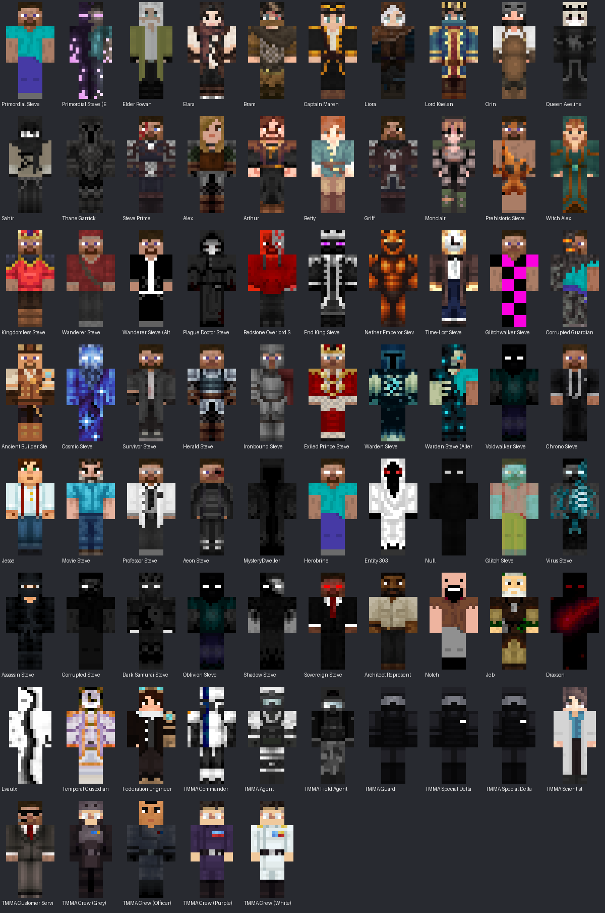
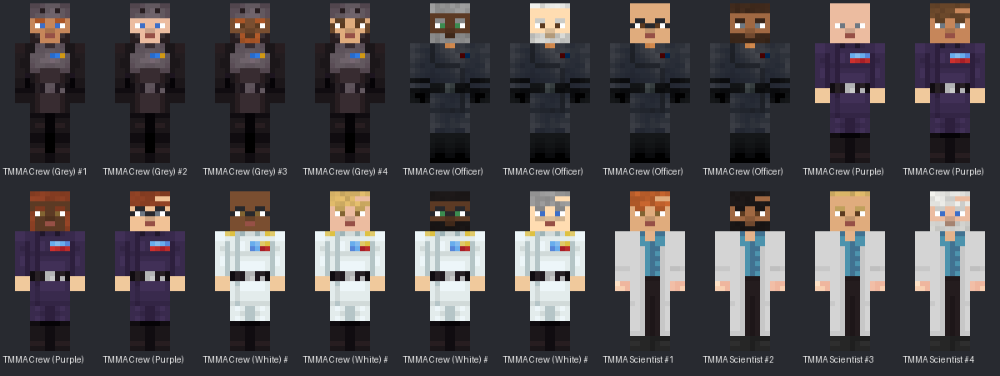
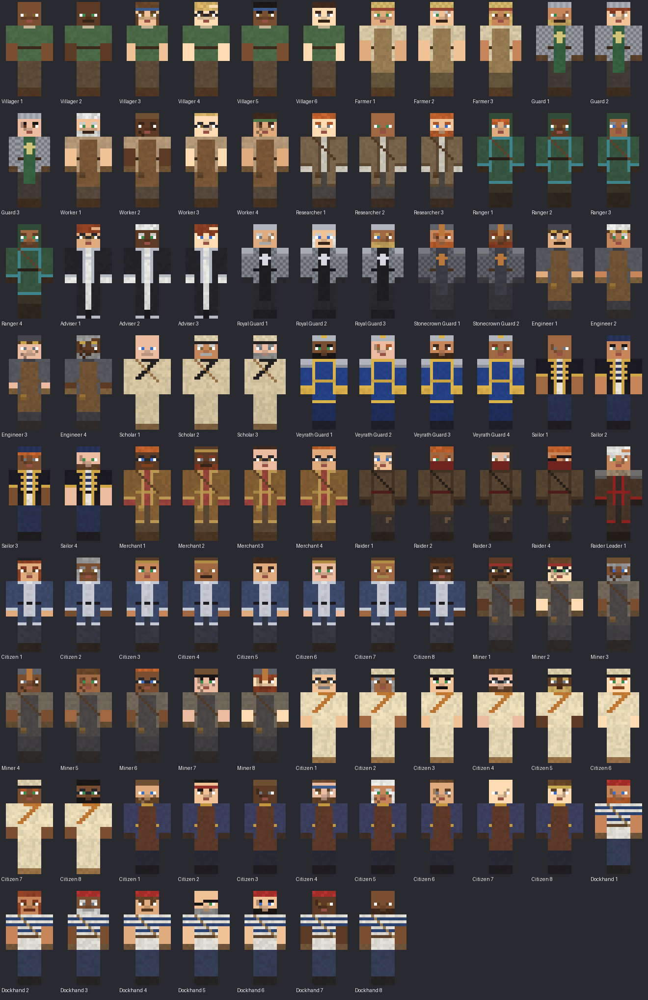

# Character Registry

Generated by `tools/skins/build_registry.py` from `tools/skins/character_seed.py`. Edit the seed, not this file.

The game loads the same data from `src/main/resources/rod-story/characters.json`.

## Identity corrections applied

- **Jesse** belongs to **MC-200** (Minecraft: Story Mode).
- **Movie Steve** belongs to **MC-300**.
- **Reuben** is **Jesse's pig** (MC-200). He uses the vanilla pig model, not a player skin.

## Saga 1 cast (MC-001)

Saga 1 scenes may only use characters cast in Saga 1. The story validator rejects any other character, so later-saga characters and Primordial Steve's Empowered form cannot appear in the opening story.

Your 11 named skins are imported from `art/skins/source/` (byte-identical copies of the collection, never modified). Each was checked: the game texture keeps every original pixel, and only fully hidden base-layer gaps are made opaque, as Minecraft does for player skins.

| Character | Faction | Saga 1 scenes | File | Model | Base-layer gaps | Overlay used | Pixels changed |
|---|---|---|---|---|---|---|---|
| Primordial Steve | Firstbrook (Eldervale) | 001–020 | PNG RGBA 64x64 | wide | none | 0% | 0 |
| Elder Rowan | Firstbrook (Eldervale) | 001, 002, 005, 020 | PNG RGBA 64x64 | slim | none | 38% | 0 |
| Elara | Firstbrook (Eldervale) | 001–020 | PNG P 64x64 | wide | none | 29% | 0 |
| Bram | Firstbrook (Eldervale) | 001, 002, 003, 005, 006, 008, 009, 010, 011, 012, 017, 018, 019, 020 | PNG P 64x64 | wide | none | 56% | 0 |
| Captain Maren | Thalassia | 016, 017, 018, 019, 020 | PNG P 64x64 | wide | 32 (body underside, rendered black as in vanilla) | 48% | 0 |
| Liora | Sylvaris | 010, 011, 012, 015, 017, 018, 019, 020 | PNG RGBA 64x64 | slim | none | 37% | 0 |
| Lord Kaelen | Veyrath | 015, 017, 018, 019, 020 | PNG P 64x64 | wide | none | 24% | 0 |
| Orin | Firstbrook (Eldervale) | 001, 004, 005, 006, 007, 013, 014, 016, 017, 018, 019, 020 | PNG P 64x64 | slim | none | 15% | 0 |
| Queen Aveline | Eldervale | 012, 013, 014, 015, 017, 020 | PNG P 64x64 | slim | none | 31% | 0 |
| Sahir | Solkar | 014, 015, 016, 017, 018, 019, 020 | PNG P 64x64 | slim | none | 24% | 0 |
| Thane Garrick | Stonecrown | 013, 015, 016, 017, 018, 019, 020 | PNG P 64x64 | wide | none | 39% | 0 |

Primordial Steve keeps his normal classic Steve skin throughout Saga 1. `primordial_steve_empowered` is registered but not cast in any saga yet.

## Open questions for the story owner

- **Witch Alex** (`witch_alex`): Shares MC-002 with Prehistoric Steve; confirm this is intended. Skin file came from Planet Minecraft, so check its licence before release.
- **Voidwalker Steve** (`voidwalker_steve`): IDENTICAL skin file to Oblivion Steve. One of them needs its own skin.
- **Aeon Steve** (`aeon_steve`): Folder marked '(Temp)': name and universe are temporary.
- **MysteryDweller** (`mystery_dweller`): Home universe not stated in the documents I have.
- **Oblivion Steve** (`oblivion_steve`): IDENTICAL skin file to Voidwalker Steve (MC-073). One of them needs its own skin.
- **Draxson** (`draxson`): Role and faction not stated in the documents I have.
- **Evaulx** (`evaulx`): Role and faction not stated in the documents I have.

## MC-001 (12)

| ID | Name | Universe | Faction | Model | Notes |
|---|---|---|---|---|---|
| `primordial_steve` | Primordial Steve | MC-001 | Firstbrook (Eldervale) | wide | His ultimate role is preserved for Saga 24. |
| `primordial_steve_empowered` | Primordial Steve (Empowered) | MC-001 | MC-001 | slim | Empowered form of Primordial Steve. Alternate form; shares identity with primordial_steve. |
| `elder_rowan` | Elder Rowan | MC-001 | Firstbrook (Eldervale) | slim |  |
| `elara` | Elara | MC-001 | Firstbrook (Eldervale) | wide |  |
| `bram` | Bram | MC-001 | Firstbrook (Eldervale) | wide |  |
| `captain_maren` | Captain Maren | MC-001 | Thalassia | wide |  |
| `liora` | Liora | MC-001 | Sylvaris | slim |  |
| `lord_kaelen` | Lord Kaelen | MC-001 | Veyrath | wide |  |
| `orin` | Orin | MC-001 | Firstbrook (Eldervale) | slim |  |
| `queen_aveline` | Queen Aveline | MC-001 | Eldervale | slim |  |
| `sahir` | Sahir | MC-001 | Solkar | slim |  |
| `thane_garrick` | Thane Garrick | MC-001 | Stonecrown | wide |  |

## MC-100 (6)

| ID | Name | Universe | Faction | Model | Notes |
|---|---|---|---|---|---|
| `steve_prime` | Steve Prime | MC-100 | MC-100 | wide |  |
| `alex_mc100` | Alex | MC-100 | MC-100 | wide |  |
| `arthur` | Arthur | MC-100 | MC-100 | wide |  |
| `betty` | Betty | MC-100 | MC-100 | slim |  |
| `griff` | Griff | MC-100 | MC-100 | wide |  |
| `monclair` | Monclair | MC-100 | MC-100 | slim |  |

## Major Steves & Crossovers (27)

| ID | Name | Universe | Faction | Model | Notes |
|---|---|---|---|---|---|
| `prehistoric_steve` | Prehistoric Steve | MC-002 | Steve variant | slim |  |
| `witch_alex` | Witch Alex | MC-002 | Alex variant | wide | Shares MC-002 with Prehistoric Steve; confirm this is intended. Skin file came from Planet Minecraft, so check its licence before release. |
| `kingdomless_steve` | Kingdomless Steve | MC-003 | Steve variant | wide |  |
| `wanderer_steve` | Wanderer Steve | MC-004 | Steve variant | wide | Two skins supplied; the second is registered as wanderer_steve_alt. |
| `wanderer_steve_alt` | Wanderer Steve (Alternate) | MC-004 | Steve variant | slim | Alternate outfit of wanderer_steve. |
| `plague_doctor_steve` | Plague Doctor Steve | MC-005 | Steve variant | wide |  |
| `redstone_overlord_steve` | Redstone Overlord Steve | MC-006 | Steve variant | wide |  |
| `end_king_steve` | End King Steve | MC-007 | Steve variant | wide |  |
| `nether_emperor_steve` | Nether Emperor Steve | MC-008 | Steve variant | wide |  |
| `time_lost_steve` | Time-Lost Steve | MC-009 | Steve variant | wide |  |
| `glitchwalker_steve` | Glitchwalker Steve | MC-010 | Steve variant | wide | Hero variant; not the villain Glitch Steve. |
| `corrupted_guardian_steve` | Corrupted Guardian Steve | MC-013 | Steve variant | wide | Folder spelled 'Corrupte'; name normalised. |
| `ancient_builder_steve` | Ancient Builder Steve | MC-014 | Steve variant | wide | Has an independent story arc (Story Expansion 1). Folder spelled 'Acient'; name normalised. |
| `cosmic_steve` | Cosmic Steve | MC-015 | Steve variant | wide | Has an independent story arc (Story Expansion 1). |
| `survivor_steve` | Survivor Steve | MC-016 | Steve variant | wide |  |
| `herald_steve` | Herald Steve | MC-017 | Steve variant | wide |  |
| `ironbound_steve` | Ironbound Steve | MC-018 | Steve variant | slim |  |
| `exiled_prince_steve` | Exiled Prince Steve | MC-019 | Steve variant | wide |  |
| `warden_steve` | Warden Steve | MC-058 | Steve variant | wide | Has an independent story arc (Story Expansion 1). Folder spelled 'Wardem'; name normalised. Two skins supplied; the second is warden_steve_alt. |
| `warden_steve_alt` | Warden Steve (Alternate) | MC-058 | Steve variant | wide | Alternate look of warden_steve. |
| `voidwalker_steve` | Voidwalker Steve | MC-073 | Steve variant | wide | IDENTICAL skin file to Oblivion Steve. One of them needs its own skin. |
| `chrono_steve` | Chrono Steve | MC-101 | Steve variant | wide |  |
| `jesse` | Jesse | MC-200 | Minecraft: Story Mode | wide | Protagonist of Minecraft: Story Mode. Reuben is Jesse's pig. Identity corrected by owner: Jesse belongs to MC-200. |
| `reuben` | Reuben | MC-200 | Minecraft: Story Mode | pig | Jesse's pig. Identity corrected by owner: Reuben is Jesse's pig, not a human character. Uses the vanilla pig model; no skin needed. |
| `movie_steve` | Movie Steve | MC-300 | Movie universe | wide | Identity corrected by owner: Movie Steve belongs to MC-300. |
| `professor_steve` | Professor Steve | MC-1323 | Steve variant | wide |  |
| `aeon_steve` | Aeon Steve | MC-TBD | Steve variant | slim | Folder marked '(Temp)': name and universe are temporary. |

## MysteryDweller (1)

| ID | Name | Universe | Faction | Model | Notes |
|---|---|---|---|---|---|
| `mystery_dweller` | MysteryDweller | — | Forgotten Steves | wide | The first Minecraft inter-universal traveller (Story Expansion 1). Home universe not stated in the documents I have. |

## Main Villains (11)

| ID | Name | Universe | Faction | Model | Notes |
|---|---|---|---|---|---|
| `herobrine` | Herobrine | — | Villain | wide | Leads a strategic campaign with consequences across multiple universes (Story Expansion 1). |
| `entity_303` | Entity 303 | — | Villain | wide |  |
| `null` | Null | — | Villain | wide |  |
| `glitch_steve` | Glitch Steve | — | Villain | wide | Villain; not the hero Glitchwalker Steve. |
| `virus_steve` | Virus Steve | — | Villain | wide |  |
| `assassin_steve` | Assassin Steve | MC-TBD | Villain | wide |  |
| `corrupted_steve` | Corrupted Steve | MC-TBD | Villain | wide |  |
| `dark_samurai_steve` | Dark Samurai Steve | MC-TBD | Villain | wide |  |
| `oblivion_steve` | Oblivion Steve | MC-TBD | Villain | wide | IDENTICAL skin file to Voidwalker Steve (MC-073). One of them needs its own skin. |
| `shadow_steve` | Shadow Steve | MC-TBD | Villain | wide |  |
| `sovereign_steve` | Sovereign Steve | MC-TBD | Villain | wide |  |

## Ancient figures, TMMA and Federation (19)

| ID | Name | Universe | Faction | Model | Notes |
|---|---|---|---|---|---|
| `architect_representative` | Architect Representative | — | Architects | wide | Speaks for the ancient Architects. |
| `notch` | Notch | — | Ancient figures | wide | Fictional in-story figure; the Notch/Jeb revelation is preserved for Saga 24. Legacy 64x32 skin; converted to 64x64. |
| `jeb` | Jeb | — | Ancient figures | wide | Fictional in-story figure; the Notch/Jeb revelation is preserved for Saga 24. Legacy 64x32 skin; converted to 64x64. |
| `draxson` | Draxson | — | Unconfirmed | wide | Role and faction not stated in the documents I have. |
| `evaulx` | Evaulx | — | Unconfirmed | slim | Role and faction not stated in the documents I have. |
| `temporal_custodian` | Temporal Custodian | — | Unconfirmed | wide |  |
| `federation_engineer` | Federation Engineer | — | Minecraft Multiverse Federation | wide | The Federation is founded on MC-001 and stays separate from the TMMA. |
| `tmma_commander` | TMMA Commander | — | TMMA | wide |  |
| `tmma_agent` | TMMA Agent | — | TMMA | wide | Helmeted uniform. |
| `tmma_field_agent` | TMMA Field Agent | — | TMMA | slim | Helmeted uniform. |
| `tmma_guard` | TMMA Guard | — | TMMA | wide | Helmeted uniform. |
| `tmma_delta_force` | TMMA Special Delta Force | — | TMMA | wide | Helmeted uniform. |
| `tmma_delta_force_b` | TMMA Special Delta Force (B) | — | TMMA | slim | Second Delta Force skin. |
| `tmma_scientist` | TMMA Scientist | — | TMMA | slim |  |
| `tmma_customer_service` | TMMA Customer Service | — | TMMA | wide | Legacy 64x32 skin; converted to 64x64. |
| `tmma_crew_grey` | TMMA Crew (Grey) | — | TMMA | slim |  |
| `tmma_crew_officer` | TMMA Crew (Officer) | — | TMMA | wide |  |
| `tmma_crew_purple` | TMMA Crew (Purple) | — | TMMA | slim | 'e91571f16e92cd96 (1).png' is a byte-identical duplicate and was skipped. |
| `tmma_crew_white` | TMMA Crew (White) | — | TMMA | slim |  |

## Generated TMMA personnel (20)

| ID | Name | Universe | Faction | Model | Notes |
|---|---|---|---|---|---|
| `tmma_crew_grey_v1` | TMMA Crew (Grey) #1 | — | TMMA | slim | Generated from the TMMA Crew (Grey) uniform: buzz ginger hair, blue eyes. Uniform pixels are identical to the template. |
| `tmma_crew_grey_v2` | TMMA Crew (Grey) #2 | — | TMMA | slim | Generated from the TMMA Crew (Grey) uniform: bald black hair, blue eyes. Uniform pixels are identical to the template. |
| `tmma_crew_grey_v3` | TMMA Crew (Grey) #3 | — | TMMA | slim | Generated from the TMMA Crew (Grey) uniform: short ginger hair, brown eyes, beard. Uniform pixels are identical to the template. |
| `tmma_crew_grey_v4` | TMMA Crew (Grey) #4 | — | TMMA | slim | Generated from the TMMA Crew (Grey) uniform: long brown hair, brown eyes. Uniform pixels are identical to the template. |
| `tmma_crew_officer_v1` | TMMA Crew (Officer) #1 | — | TMMA | wide | Generated from the TMMA Crew (Officer) uniform: bun grey hair, green eyes, beard. Uniform pixels are identical to the template. |
| `tmma_crew_officer_v2` | TMMA Crew (Officer) #2 | — | TMMA | wide | Generated from the TMMA Crew (Officer) uniform: buzz white hair, brown eyes, beard. Uniform pixels are identical to the template. |
| `tmma_crew_officer_v3` | TMMA Crew (Officer) #3 | — | TMMA | wide | Generated from the TMMA Crew (Officer) uniform: bald black hair, brown eyes, glasses. Uniform pixels are identical to the template. |
| `tmma_crew_officer_v4` | TMMA Crew (Officer) #4 | — | TMMA | wide | Generated from the TMMA Crew (Officer) uniform: short dark brown hair, grey eyes, beard. Uniform pixels are identical to the template. |
| `tmma_crew_purple_v1` | TMMA Crew (Purple) #1 | — | TMMA | slim | Generated from the TMMA Crew (Purple) uniform: bald black hair, grey eyes. Uniform pixels are identical to the template. |
| `tmma_crew_purple_v2` | TMMA Crew (Purple) #2 | — | TMMA | slim | Generated from the TMMA Crew (Purple) uniform: swept brown hair, grey eyes. Uniform pixels are identical to the template. |
| `tmma_crew_purple_v3` | TMMA Crew (Purple) #3 | — | TMMA | slim | Generated from the TMMA Crew (Purple) uniform: long auburn hair, hazel eyes. Uniform pixels are identical to the template. |
| `tmma_crew_purple_v4` | TMMA Crew (Purple) #4 | — | TMMA | slim | Generated from the TMMA Crew (Purple) uniform: swept auburn hair, grey eyes, glasses. Uniform pixels are identical to the template. |
| `tmma_crew_white_v1` | TMMA Crew (White) #1 | — | TMMA | slim | Generated from the TMMA Crew (White) uniform: bald white hair, hazel eyes, glasses. Uniform pixels are identical to the template. |
| `tmma_crew_white_v2` | TMMA Crew (White) #2 | — | TMMA | slim | Generated from the TMMA Crew (White) uniform: swept blonde hair, hazel eyes. Uniform pixels are identical to the template. |
| `tmma_crew_white_v3` | TMMA Crew (White) #3 | — | TMMA | slim | Generated from the TMMA Crew (White) uniform: short black hair, green eyes, beard, glasses. Uniform pixels are identical to the template. |
| `tmma_crew_white_v4` | TMMA Crew (White) #4 | — | TMMA | slim | Generated from the TMMA Crew (White) uniform: swept grey hair, blue eyes, freckles. Uniform pixels are identical to the template. |
| `tmma_scientist_v1` | TMMA Scientist #1 | — | TMMA | slim | Generated from the TMMA Scientist uniform: swept ginger hair, hazel eyes. Uniform pixels are identical to the template. |
| `tmma_scientist_v2` | TMMA Scientist #2 | — | TMMA | slim | Generated from the TMMA Scientist uniform: swept black hair, brown eyes, beard. Uniform pixels are identical to the template. |
| `tmma_scientist_v3` | TMMA Scientist #3 | — | TMMA | slim | Generated from the TMMA Scientist uniform: buzz blonde hair, brown eyes. Uniform pixels are identical to the template. |
| `tmma_scientist_v4` | TMMA Scientist #4 | — | TMMA | slim | Generated from the TMMA Scientist uniform: swept white hair, blue eyes, beard. Uniform pixels are identical to the template. |

## MC-001 Saga 1 NPCs (95)

| ID | Name | Universe | Faction | Model | Notes |
|---|---|---|---|---|---|
| `firstbrook_villager_1` | Firstbrook Villager #1 | MC-001 | Firstbrook (Eldervale) | wide | Residents of Firstbrook; Scene 005's volunteers are drawn from them. Generated NPC appearance: bald white hair, hazel eyes, freckles. Outfit shared by every Firstbrook Villager. |
| `firstbrook_villager_2` | Firstbrook Villager #2 | MC-001 | Firstbrook (Eldervale) | wide | Residents of Firstbrook; Scene 005's volunteers are drawn from them. Generated NPC appearance: bald black hair, green eyes, moustache, earring. Outfit shared by every Firstbrook Villager. |
| `firstbrook_villager_3` | Firstbrook Villager #3 | MC-001 | Firstbrook (Eldervale) | slim | Residents of Firstbrook; Scene 005's volunteers are drawn from them. Generated NPC appearance: long brown hair, hazel eyes, freckles, headband. Outfit shared by every Firstbrook Villager. |
| `firstbrook_villager_4` | Firstbrook Villager #4 | MC-001 | Firstbrook (Eldervale) | wide | Residents of Firstbrook; Scene 005's volunteers are drawn from them. Generated NPC appearance: swept blonde hair, brown eyes, glasses, freckles. Outfit shared by every Firstbrook Villager. |
| `firstbrook_villager_5` | Firstbrook Villager #5 | MC-001 | Firstbrook (Eldervale) | wide | Residents of Firstbrook; Scene 005's volunteers are drawn from them. Generated NPC appearance: short black hair, hazel eyes, freckles, headband. Outfit shared by every Firstbrook Villager. |
| `firstbrook_villager_6` | Firstbrook Villager #6 | MC-001 | Firstbrook (Eldervale) | slim | Residents of Firstbrook; Scene 005's volunteers are drawn from them. Generated NPC appearance: bun dark brown hair, grey eyes, moustache. Outfit shared by every Firstbrook Villager. |
| `firstbrook_farmer_1` | Firstbrook Farmer #1 | MC-001 | Firstbrook (Eldervale) | wide | Farmers working Firstbrook's fields. Generated NPC appearance: buzz blonde hair, green eyes, freckles, straw hat. Outfit shared by every Firstbrook Farmer. |
| `firstbrook_farmer_2` | Firstbrook Farmer #2 | MC-001 | Firstbrook (Eldervale) | wide | Farmers working Firstbrook's fields. Generated NPC appearance: swept white hair, green eyes, moustache, scar, straw hat. Outfit shared by every Firstbrook Farmer. |
| `firstbrook_farmer_3` | Firstbrook Farmer #3 | MC-001 | Firstbrook (Eldervale) | slim | Farmers working Firstbrook's fields. Generated NPC appearance: long blonde hair, brown eyes, freckles, straw hat. Outfit shared by every Firstbrook Farmer. |
| `firstbrook_guard_1` | Firstbrook Guard #1 | MC-001 | Firstbrook (Eldervale) | wide | Village guards who patrol the paths and the north gate. Generated NPC appearance: bald blonde hair, green eyes, beard, scar, moustache, kettle helm. Outfit shared by every Firstbrook Guard. |
| `firstbrook_guard_2` | Firstbrook Guard #2 | MC-001 | Firstbrook (Eldervale) | wide | Village guards who patrol the paths and the north gate. Generated NPC appearance: swept auburn hair, grey eyes, scar, kettle helm. Outfit shared by every Firstbrook Guard. |
| `firstbrook_guard_3` | Firstbrook Guard #3 | MC-001 | Firstbrook (Eldervale) | slim | Village guards who patrol the paths and the north gate. Generated NPC appearance: buzz black hair, brown eyes, scar, kettle helm. Outfit shared by every Firstbrook Guard. |
| `expedition_worker_1` | Expedition Worker #1 | MC-001 | Eldervale | wide | Road and excavation workers; Eldervale's supply crews at the monument. Generated NPC appearance: bun white hair, green eyes, beard, freckles, moustache. Outfit shared by every Expedition Worker. |
| `expedition_worker_2` | Expedition Worker #2 | MC-001 | Eldervale | wide | Road and excavation workers; Eldervale's supply crews at the monument. Generated NPC appearance: short dark brown hair, brown eyes, scar, soot smudges, leather cap. Outfit shared by every Expedition Worker. |
| `expedition_worker_3` | Expedition Worker #3 | MC-001 | Eldervale | slim | Road and excavation workers; Eldervale's supply crews at the monument. Generated NPC appearance: buzz blonde hair, hazel eyes, glasses, scar. Outfit shared by every Expedition Worker. |
| `expedition_worker_4` | Expedition Worker #4 | MC-001 | Eldervale | wide | Road and excavation workers; Eldervale's supply crews at the monument. Generated NPC appearance: bun dark brown hair, brown eyes, scar, soot smudges, headband. Outfit shared by every Expedition Worker. |
| `expedition_researcher_1` | Expedition Researcher #1 | MC-001 | Eldervale | wide | Researchers inspecting the sealed chamber. Generated NPC appearance: bun ginger hair, grey eyes, earring. Outfit shared by every Expedition Researcher. |
| `expedition_researcher_2` | Expedition Researcher #2 | MC-001 | Eldervale | wide | Researchers inspecting the sealed chamber. Generated NPC appearance: bald ginger hair, green eyes, earring. Outfit shared by every Expedition Researcher. |
| `expedition_researcher_3` | Expedition Researcher #3 | MC-001 | Eldervale | slim | Researchers inspecting the sealed chamber. Generated NPC appearance: short ginger hair, blue eyes, beard, earring. Outfit shared by every Expedition Researcher. |
| `sylvaris_ranger_1` | Sylvaris Ranger #1 | MC-001 | Sylvaris | wide | Forest rangers who serve with Liora. Generated NPC appearance: swept ginger hair, grey eyes, earring, green hood. Outfit shared by every Sylvaris Ranger. |
| `sylvaris_ranger_2` | Sylvaris Ranger #2 | MC-001 | Sylvaris | wide | Forest rangers who serve with Liora. Generated NPC appearance: bald auburn hair, hazel eyes, earring, teal face paint, green hood. Outfit shared by every Sylvaris Ranger. |
| `sylvaris_ranger_3` | Sylvaris Ranger #3 | MC-001 | Sylvaris | slim | Forest rangers who serve with Liora. Generated NPC appearance: buzz grey hair, blue eyes, earring, green hood. Outfit shared by every Sylvaris Ranger. |
| `sylvaris_ranger_4` | Sylvaris Ranger #4 | MC-001 | Sylvaris | wide | Forest rangers who serve with Liora. Generated NPC appearance: buzz brown hair, green eyes, beard, teal face paint, green hood. Outfit shared by every Sylvaris Ranger. |
| `eldervale_official_1` | Eldervale Official #1 | MC-001 | Eldervale | wide | Queen Aveline's advisers at the Valebridge council. Generated NPC appearance: swept auburn hair, hazel eyes, earring, glasses. Outfit shared by every Eldervale Official. |
| `eldervale_official_2` | Eldervale Official #2 | MC-001 | Eldervale | wide | Queen Aveline's advisers at the Valebridge council. Generated NPC appearance: bun white hair, green eyes, earring. Outfit shared by every Eldervale Official. |
| `eldervale_official_3` | Eldervale Official #3 | MC-001 | Eldervale | slim | Queen Aveline's advisers at the Valebridge council. Generated NPC appearance: swept auburn hair, blue eyes, earring. Outfit shared by every Eldervale Official. |
| `eldervale_royal_guard_1` | Eldervale Royal Guard #1 | MC-001 | Eldervale | wide | The Queen's guard in Valebridge. Generated NPC appearance: buzz white hair, grey eyes, moustache, scar, royal helm. Outfit shared by every Eldervale Royal Guard. |
| `eldervale_royal_guard_2` | Eldervale Royal Guard #2 | MC-001 | Eldervale | wide | The Queen's guard in Valebridge. Generated NPC appearance: long white hair, blue eyes, moustache, royal helm. Outfit shared by every Eldervale Royal Guard. |
| `eldervale_royal_guard_3` | Eldervale Royal Guard #3 | MC-001 | Eldervale | slim | The Queen's guard in Valebridge. Generated NPC appearance: buzz blonde hair, blue eyes, beard, moustache, scar, royal helm. Outfit shared by every Eldervale Royal Guard. |
| `stonecrown_guard_1` | Stonecrown Guard #1 | MC-001 | Stonecrown | wide | Thane Garrick's escorts carrying the Irondeep stone. Generated NPC appearance: short ginger hair, brown eyes, beard, scar, iron helm. Outfit shared by every Stonecrown Guard. |
| `stonecrown_guard_2` | Stonecrown Guard #2 | MC-001 | Stonecrown | wide | Thane Garrick's escorts carrying the Irondeep stone. Generated NPC appearance: bun auburn hair, hazel eyes, beard, scar, iron helm. Outfit shared by every Stonecrown Guard. |
| `stonecrown_engineer_1` | Stonecrown Engineer #1 | MC-001 | Stonecrown | wide | Engineers who build the excavation supports. Generated NPC appearance: buzz dark brown hair, grey eyes, moustache, goggles and cap. Outfit shared by every Stonecrown Engineer. |
| `stonecrown_engineer_2` | Stonecrown Engineer #2 | MC-001 | Stonecrown | wide | Engineers who build the excavation supports. Generated NPC appearance: bun white hair, green eyes, scar, goggles. Outfit shared by every Stonecrown Engineer. |
| `stonecrown_engineer_3` | Stonecrown Engineer #3 | MC-001 | Stonecrown | slim | Engineers who build the excavation supports. Generated NPC appearance: bald dark brown hair, grey eyes, soot smudges, moustache, goggles and cap. Outfit shared by every Stonecrown Engineer. |
| `stonecrown_engineer_4` | Stonecrown Engineer #4 | MC-001 | Stonecrown | wide | Engineers who build the excavation supports. Generated NPC appearance: swept grey hair, brown eyes, beard, soot smudges, scar, goggles. Outfit shared by every Stonecrown Engineer. |
| `solkar_scholar_1` | Solkar Scholar #1 | MC-001 | Solkar | wide | Scholars of Sunspire who travel with Sahir. Generated NPC appearance: bald black hair, blue eyes, moustache. Outfit shared by every Solkar Scholar. |
| `solkar_scholar_2` | Solkar Scholar #2 | MC-001 | Solkar | wide | Scholars of Sunspire who travel with Sahir. Generated NPC appearance: bun white hair, hazel eyes, moustache, glasses, headwrap. Outfit shared by every Solkar Scholar. |
| `solkar_scholar_3` | Solkar Scholar #3 | MC-001 | Solkar | slim | Scholars of Sunspire who travel with Sahir. Generated NPC appearance: buzz grey hair, grey eyes, beard, earring, headwrap. Outfit shared by every Solkar Scholar. |
| `veyrath_guard_1` | Veyrath Honour Guard #1 | MC-001 | Veyrath | wide | Lord Kaelen's armed honour guard from Emberhold. Generated NPC appearance: short black hair, green eyes, beard, earring, crested helm. Outfit shared by every Veyrath Honour Guard. |
| `veyrath_guard_2` | Veyrath Honour Guard #2 | MC-001 | Veyrath | wide | Lord Kaelen's armed honour guard from Emberhold. Generated NPC appearance: short ginger hair, hazel eyes, scar, crested helm. Outfit shared by every Veyrath Honour Guard. |
| `veyrath_guard_3` | Veyrath Honour Guard #3 | MC-001 | Veyrath | slim | Lord Kaelen's armed honour guard from Emberhold. Generated NPC appearance: bun dark brown hair, brown eyes, beard, earring, crested helm. Outfit shared by every Veyrath Honour Guard. |
| `veyrath_guard_4` | Veyrath Honour Guard #4 | MC-001 | Veyrath | wide | Lord Kaelen's armed honour guard from Emberhold. Generated NPC appearance: short auburn hair, green eyes, scar, crested helm. Outfit shared by every Veyrath Honour Guard. |
| `thalassian_sailor_1` | Thalassian Sailor #1 | MC-001 | Thalassia | wide | Captain Maren's harbour crew and rope specialists. Generated NPC appearance: bald white hair, grey eyes, earring, scar. Outfit shared by every Thalassian Sailor. |
| `thalassian_sailor_2` | Thalassian Sailor #2 | MC-001 | Thalassia | wide | Captain Maren's harbour crew and rope specialists. Generated NPC appearance: buzz black hair, grey eyes, earring, knit cap. Outfit shared by every Thalassian Sailor. |
| `thalassian_sailor_3` | Thalassian Sailor #3 | MC-001 | Thalassia | slim | Captain Maren's harbour crew and rope specialists. Generated NPC appearance: swept ginger hair, grey eyes, scar, knit cap. Outfit shared by every Thalassian Sailor. |
| `thalassian_sailor_4` | Thalassian Sailor #4 | MC-001 | Thalassia | wide | Captain Maren's harbour crew and rope specialists. Generated NPC appearance: bald brown hair, green eyes, beard, scar, knit cap. Outfit shared by every Thalassian Sailor. |
| `merchant_1` | Travelling Merchant #1 | MC-001 | Independent traders | wide | The eastern road caravan and Valebridge's market. Generated NPC appearance: bun ginger hair, blue eyes, glasses, moustache. Outfit shared by every Travelling Merchant. |
| `merchant_2` | Travelling Merchant #2 | MC-001 | Independent traders | wide | The eastern road caravan and Valebridge's market. Generated NPC appearance: bun auburn hair, grey eyes, beard, moustache, felt hat. Outfit shared by every Travelling Merchant. |
| `merchant_3` | Travelling Merchant #3 | MC-001 | Independent traders | slim | The eastern road caravan and Valebridge's market. Generated NPC appearance: buzz dark brown hair, hazel eyes, glasses. Outfit shared by every Travelling Merchant. |
| `merchant_4` | Travelling Merchant #4 | MC-001 | Independent traders | wide | The eastern road caravan and Valebridge's market. Generated NPC appearance: buzz ginger hair, grey eyes, glasses. Outfit shared by every Travelling Merchant. |
| `raider_1` | Raider #1 | MC-001 | Eastern road raiders | wide | Human raiders who attack the caravan. Generated NPC appearance: buzz grey hair, blue eyes, soot smudges, hood. Outfit shared by every Raider. |
| `raider_2` | Raider #2 | MC-001 | Eastern road raiders | wide | Human raiders who attack the caravan. Generated NPC appearance: bun ginger hair, green eyes, scar, face cloth. Outfit shared by every Raider. |
| `raider_3` | Raider #3 | MC-001 | Eastern road raiders | slim | Human raiders who attack the caravan. Generated NPC appearance: long white hair, hazel eyes, scar, hood and face cloth. Outfit shared by every Raider. |
| `raider_4` | Raider #4 | MC-001 | Eastern road raiders | wide | Human raiders who attack the caravan. Generated NPC appearance: bun ginger hair, hazel eyes, eyepatch, scar, face cloth. Outfit shared by every Raider. |
| `raider_leader_1` | Raider Leader #1 | MC-001 | Eastern road raiders | wide | Leader of the eastern road raiders. Generated NPC appearance: swept white hair, green eyes, scar. Outfit shared by every Raider Leader. |
| `valebridge_citizen_1` | Valebridge Citizen #1 | MC-001 | Eldervale | wide | Residents of Valebridge, Eldervale's capital. Generated NPC appearance: long auburn hair, brown eyes, glasses, earring, black coif. Outfit shared by every Valebridge Citizen. |
| `valebridge_citizen_2` | Valebridge Citizen #2 | MC-001 | Eldervale | wide | Residents of Valebridge, Eldervale's capital. Generated NPC appearance: long grey hair, hazel eyes, freckles, earring. Outfit shared by every Valebridge Citizen. |
| `valebridge_citizen_3` | Valebridge Citizen #3 | MC-001 | Eldervale | slim | Residents of Valebridge, Eldervale's capital. Generated NPC appearance: buzz dark brown hair, green eyes, earring, felt hat. Outfit shared by every Valebridge Citizen. |
| `valebridge_citizen_4` | Valebridge Citizen #4 | MC-001 | Eldervale | wide | Residents of Valebridge, Eldervale's capital. Generated NPC appearance: bald ginger hair, hazel eyes, earring, moustache, felt hat. Outfit shared by every Valebridge Citizen. |
| `valebridge_citizen_5` | Valebridge Citizen #5 | MC-001 | Eldervale | wide | Residents of Valebridge, Eldervale's capital. Generated NPC appearance: bun dark brown hair, brown eyes, earring. Outfit shared by every Valebridge Citizen. |
| `valebridge_citizen_6` | Valebridge Citizen #6 | MC-001 | Eldervale | slim | Residents of Valebridge, Eldervale's capital. Generated NPC appearance: short brown hair, green eyes, freckles, felt hat. Outfit shared by every Valebridge Citizen. |
| `valebridge_citizen_7` | Valebridge Citizen #7 | MC-001 | Eldervale | wide | Residents of Valebridge, Eldervale's capital. Generated NPC appearance: short blonde hair, brown eyes, moustache, felt hat. Outfit shared by every Valebridge Citizen. |
| `valebridge_citizen_8` | Valebridge Citizen #8 | MC-001 | Eldervale | wide | Residents of Valebridge, Eldervale's capital. Generated NPC appearance: long dark brown hair, grey eyes, freckles. Outfit shared by every Valebridge Citizen. |
| `irondeep_miner_1` | Irondeep Miner #1 | MC-001 | Stonecrown | wide | Miners, smiths and residents of Irondeep. Generated NPC appearance: bald black hair, hazel eyes, soot smudges, moustache, headband. Outfit shared by every Irondeep Miner. |
| `irondeep_miner_2` | Irondeep Miner #2 | MC-001 | Stonecrown | wide | Miners, smiths and residents of Irondeep. Generated NPC appearance: bun brown hair, green eyes, freckles, scar, soot smudges, headband. Outfit shared by every Irondeep Miner. |
| `irondeep_miner_3` | Irondeep Miner #3 | MC-001 | Stonecrown | slim | Miners, smiths and residents of Irondeep. Generated NPC appearance: swept grey hair, blue eyes, beard, soot smudges, scar, leather cap. Outfit shared by every Irondeep Miner. |
| `irondeep_miner_4` | Irondeep Miner #4 | MC-001 | Stonecrown | wide | Miners, smiths and residents of Irondeep. Generated NPC appearance: bald auburn hair, grey eyes, scar, soot smudges, iron helm. Outfit shared by every Irondeep Miner. |
| `irondeep_miner_5` | Irondeep Miner #5 | MC-001 | Stonecrown | wide | Miners, smiths and residents of Irondeep. Generated NPC appearance: bun brown hair, green eyes, soot smudges, scar. Outfit shared by every Irondeep Miner. |
| `irondeep_miner_6` | Irondeep Miner #6 | MC-001 | Stonecrown | slim | Miners, smiths and residents of Irondeep. Generated NPC appearance: buzz ginger hair, blue eyes, glasses, soot smudges. Outfit shared by every Irondeep Miner. |
| `irondeep_miner_7` | Irondeep Miner #7 | MC-001 | Stonecrown | wide | Miners, smiths and residents of Irondeep. Generated NPC appearance: swept black hair, green eyes, soot smudges, scar, leather cap. Outfit shared by every Irondeep Miner. |
| `irondeep_miner_8` | Irondeep Miner #8 | MC-001 | Stonecrown | wide | Miners, smiths and residents of Irondeep. Generated NPC appearance: swept auburn hair, brown eyes, beard, freckles, scar, moustache, iron helm. Outfit shared by every Irondeep Miner. |
| `sunspire_citizen_1` | Sunspire Citizen #1 | MC-001 | Solkar | wide | Residents, traders and copyists of Sunspire. Generated NPC appearance: short grey hair, hazel eyes, freckles, moustache, glasses. Outfit shared by every Sunspire Citizen. |
| `sunspire_citizen_2` | Sunspire Citizen #2 | MC-001 | Solkar | wide | Residents, traders and copyists of Sunspire. Generated NPC appearance: long grey hair, brown eyes, glasses, headwrap. Outfit shared by every Sunspire Citizen. |
| `sunspire_citizen_3` | Sunspire Citizen #3 | MC-001 | Solkar | slim | Residents, traders and copyists of Sunspire. Generated NPC appearance: short black hair, green eyes, moustache, headwrap. Outfit shared by every Sunspire Citizen. |
| `sunspire_citizen_4` | Sunspire Citizen #4 | MC-001 | Solkar | wide | Residents, traders and copyists of Sunspire. Generated NPC appearance: short brown hair, grey eyes, beard, glasses, earring. Outfit shared by every Sunspire Citizen. |
| `sunspire_citizen_5` | Sunspire Citizen #5 | MC-001 | Solkar | wide | Residents, traders and copyists of Sunspire. Generated NPC appearance: buzz blonde hair, grey eyes, beard, earring, headwrap. Outfit shared by every Sunspire Citizen. |
| `sunspire_citizen_6` | Sunspire Citizen #6 | MC-001 | Solkar | slim | Residents, traders and copyists of Sunspire. Generated NPC appearance: buzz ginger hair, green eyes, moustache, earring, headwrap. Outfit shared by every Sunspire Citizen. |
| `sunspire_citizen_7` | Sunspire Citizen #7 | MC-001 | Solkar | wide | Residents, traders and copyists of Sunspire. Generated NPC appearance: swept ginger hair, green eyes, glasses, headwrap. Outfit shared by every Sunspire Citizen. |
| `sunspire_citizen_8` | Sunspire Citizen #8 | MC-001 | Solkar | wide | Residents, traders and copyists of Sunspire. Generated NPC appearance: bun black hair, green eyes, beard, glasses. Outfit shared by every Sunspire Citizen. |
| `emberhold_citizen_1` | Emberhold Citizen #1 | MC-001 | Veyrath | wide | Forge workers and residents of Emberhold. Generated NPC appearance: bald brown hair, blue eyes, beard, soot smudges, leather cap. Outfit shared by every Emberhold Citizen. |
| `emberhold_citizen_2` | Emberhold Citizen #2 | MC-001 | Veyrath | wide | Forge workers and residents of Emberhold. Generated NPC appearance: buzz black hair, hazel eyes, scar, earring, headband. Outfit shared by every Emberhold Citizen. |
| `emberhold_citizen_3` | Emberhold Citizen #3 | MC-001 | Veyrath | slim | Forge workers and residents of Emberhold. Generated NPC appearance: short brown hair, grey eyes, earring, scar, leather cap. Outfit shared by every Emberhold Citizen. |
| `emberhold_citizen_4` | Emberhold Citizen #4 | MC-001 | Veyrath | wide | Forge workers and residents of Emberhold. Generated NPC appearance: buzz brown hair, hazel eyes, beard, scar, earring, headband. Outfit shared by every Emberhold Citizen. |
| `emberhold_citizen_5` | Emberhold Citizen #5 | MC-001 | Veyrath | wide | Forge workers and residents of Emberhold. Generated NPC appearance: long white hair, green eyes, soot smudges. Outfit shared by every Emberhold Citizen. |
| `emberhold_citizen_6` | Emberhold Citizen #6 | MC-001 | Veyrath | slim | Forge workers and residents of Emberhold. Generated NPC appearance: buzz brown hair, grey eyes, scar, soot smudges. Outfit shared by every Emberhold Citizen. |
| `emberhold_citizen_7` | Emberhold Citizen #7 | MC-001 | Veyrath | wide | Forge workers and residents of Emberhold. Generated NPC appearance: bald auburn hair, grey eyes, scar. Outfit shared by every Emberhold Citizen. |
| `emberhold_citizen_8` | Emberhold Citizen #8 | MC-001 | Veyrath | wide | Forge workers and residents of Emberhold. Generated NPC appearance: bun brown hair, blue eyes, scar, earring, headband. Outfit shared by every Emberhold Citizen. |
| `tidewatch_dockhand_1` | Tidewatch Dockhand #1 | MC-001 | Thalassia | wide | Dock workers, divers and fishers of Tidewatch. Generated NPC appearance: bald ginger hair, blue eyes, beard, scar, eyepatch, bandana. Outfit shared by every Tidewatch Dockhand. |
| `tidewatch_dockhand_2` | Tidewatch Dockhand #2 | MC-001 | Thalassia | wide | Dock workers, divers and fishers of Tidewatch. Generated NPC appearance: long auburn hair, brown eyes, moustache. Outfit shared by every Tidewatch Dockhand. |
| `tidewatch_dockhand_3` | Tidewatch Dockhand #3 | MC-001 | Thalassia | slim | Dock workers, divers and fishers of Tidewatch. Generated NPC appearance: buzz white hair, grey eyes, beard, moustache, bandana. Outfit shared by every Tidewatch Dockhand. |
| `tidewatch_dockhand_4` | Tidewatch Dockhand #4 | MC-001 | Thalassia | wide | Dock workers, divers and fishers of Tidewatch. Generated NPC appearance: swept brown hair, brown eyes, moustache, bandana. Outfit shared by every Tidewatch Dockhand. |
| `tidewatch_dockhand_5` | Tidewatch Dockhand #5 | MC-001 | Thalassia | wide | Dock workers, divers and fishers of Tidewatch. Generated NPC appearance: bald grey hair, green eyes, beard, eyepatch, earring. Outfit shared by every Tidewatch Dockhand. |
| `tidewatch_dockhand_6` | Tidewatch Dockhand #6 | MC-001 | Thalassia | slim | Dock workers, divers and fishers of Tidewatch. Generated NPC appearance: short black hair, blue eyes, beard, scar, bandana. Outfit shared by every Tidewatch Dockhand. |
| `tidewatch_dockhand_7` | Tidewatch Dockhand #7 | MC-001 | Thalassia | wide | Dock workers, divers and fishers of Tidewatch. Generated NPC appearance: bald brown hair, hazel eyes, scar, bandana. Outfit shared by every Tidewatch Dockhand. |
| `tidewatch_dockhand_8` | Tidewatch Dockhand #8 | MC-001 | Thalassia | wide | Dock workers, divers and fishers of Tidewatch. Generated NPC appearance: bald dark brown hair, brown eyes, beard, earring. Outfit shared by every Tidewatch Dockhand. |

Every member of a type wears the same outfit, pixel for pixel (checked when the textures are built). Faces, skin tones, hair, builds and identifying features differ, and no two generated NPCs share a face. Faction colours follow each civilisation's named leader in your collection.

| Type | Speaker | Faction | Universe | Count | Saga 1 scenes | Headwear options |
|---|---|---|---|---|---|---|
| Firstbrook Villager (`firstbrook_villager_N`) | Villager | Firstbrook (Eldervale) | MC-001 | 6 | 001, 005, 020 | bare head, headband |
| Firstbrook Farmer (`firstbrook_farmer_N`) | Farmer | Firstbrook (Eldervale) | MC-001 | 3 | 001, 020 | bare head, straw hat |
| Firstbrook Guard (`firstbrook_guard_N`) | Guard | Firstbrook (Eldervale) | MC-001 | 3 | 001, 005, 020 | kettle helm |
| Expedition Worker (`expedition_worker_N`) | Worker | Eldervale | MC-001 | 4 | 005, 018, 019, 020 | bare head, headband, leather cap |
| Expedition Researcher (`expedition_researcher_N`) | Researcher | Eldervale | MC-001 | 3 | 018, 019, 020 | bare head |
| Sylvaris Ranger (`sylvaris_ranger_N`) | Ranger | Sylvaris | MC-001 | 4 | 010, 018, 019 | hood green |
| Eldervale Official (`eldervale_official_N`) | Adviser | Eldervale | MC-001 | 3 | 012, 013, 014, 015, 017 | bare head, coif |
| Eldervale Royal Guard (`eldervale_royal_guard_N`) | Royal Guard | Eldervale | MC-001 | 3 | 012, 013, 014, 015, 017, 020 | royal helm |
| Stonecrown Guard (`stonecrown_guard_N`) | Stonecrown Guard | Stonecrown | MC-001 | 2 | 013 | iron helm |
| Stonecrown Engineer (`stonecrown_engineer_N`) | Engineer | Stonecrown | MC-001 | 4 | 018, 019, 020 | goggles, goggles cap |
| Solkar Scholar (`solkar_scholar_N`) | Scholar | Solkar | MC-001 | 3 | 014, 018, 019 | bare head, headwrap |
| Veyrath Honour Guard (`veyrath_guard_N`) | Veyrath Guard | Veyrath | MC-001 | 4 | 015, 017, 018, 019 | veyrath helm |
| Thalassian Sailor (`thalassian_sailor_N`) | Sailor | Thalassia | MC-001 | 4 | 016, 018, 019 | bandana, bare head, knit cap |
| Travelling Merchant (`merchant_N`) | Merchant | Independent traders | MC-001 | 4 | 011, 012 | bare head, felt hat |
| Raider (`raider_N`) | Raider | Eastern road raiders | MC-001 | 4 | 011 | face cloth, raider hood, raider hood cloth |
| Raider Leader (`raider_leader_N`) | Raider Leader | Eastern road raiders | MC-001 | 1 | 011 | bare head |
| Valebridge Citizen (`valebridge_citizen_N`) | Citizen | Eldervale | MC-001 | 8 | 012, 017 | bare head, coif, felt hat |
| Irondeep Miner (`irondeep_miner_N`) | Miner | Stonecrown | MC-001 | 8 | 013 | bare head, headband, iron helm, leather cap |
| Sunspire Citizen (`sunspire_citizen_N`) | Citizen | Solkar | MC-001 | 8 | 014 | bare head, headwrap |
| Emberhold Citizen (`emberhold_citizen_N`) | Citizen | Veyrath | MC-001 | 8 | 015 | bare head, headband, leather cap |
| Tidewatch Dockhand (`tidewatch_dockhand_N`) | Dockhand | Thalassia | MC-001 | 8 | 016 | bandana, bare head, knit cap |

